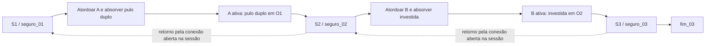

# A02 — Escopo, requisitos, regras e modelos de Cyra

**Preparação documental:** 22/10/2026. **Versão:** D02 revisada por decisões humanas registradas em P03. **Revisão informada:** Caio, Lucas e Victor, 22/10/2026, 15:02–15:35 (America/Sao_Paulo), 33 minutos de reunião conjunta. **Situação:** A02/T01 aprovadas documentalmente com ajustes, conforme decisões e confirmações humanas em P03. Não corresponde à aprovação de mecânicas implementadas. A janela planejada de 15–18/10 não é a data de execução deste documento.

O documento consolida a conferência da fonte e dos modelos existentes e propõe contratos para A05–A09. Não implementa mecânicas, modifica o jogo ou declara testes futuros executados. A01/T00 possuem validação humana registrada; a revisão de regras da A02 está registrada na evidência T01, sem aprovação dos testes futuros. Não foi encontrado outro documento consolidado equivalente à A02; os materiais anteriores são referenciados e preservados.

## 1. Fontes, precedência e estado confirmado

### 1.1 Fontes consultadas

As páginas de S01 são as posições físicas do PDF de nove páginas, contadas a partir de 1; não correspondem ao rodapé `tempfile_51932.docx`.

| Ref. | Fonte | Uso nesta conferência |
|---|---|---|
| S01 | [Relatório parcial/final assinado indicado pelo grupo](<C:/Users/caio/Downloads/(CLV) LES - 5 - Relatorio_Parcial_Final_ADS_assinado (1).pdf>) | Fonte primária: regras p. 1–3; RF p. 3–4; RNF p. 4; casos de uso e dados p. 5; persistência e metodologia anterior p. 6. Acessível; texto extraído e páginas 2–6 conferidas visualmente. Não foi substituído pelo PDF homônimo do repositório. |
| S02 | [AGENTS.md](../AGENTS.md) e pedido P02 | Limites atuais do grupo: três seções, dois tipos copiáveis/duas habilidades, dois bloqueios, um save local, física nativa, assets/narrativa humanos; somente documentação nesta tarefa. |
| S03 | [Cronograma atualizado em 15/10](Cronograma_Cyra_15-10_a_23-11-2026.md) | Decisão registrada de retirar comparação manual independente; planejamento e divisão de responsabilidades, sem comprovar execução. |
| S04 | [Guia de atividades](Guia_atividades_Cyra_2026.md), A02 e atividades relacionadas | Sugestões de percurso, habilidades, testes, reinício e avaliação; exemplos não são aprovações humanas de mecânicas. |
| S05 | [Diário](Diario_Experimento_Cyra.md), [prompts](Prompts_Utilizados.md), [README](../README.md) e histórico Git local | Estado real da A01 e rastreabilidade anterior. |
| S06 | [Untitled Diagram.png](<arquivos_tcc/Untitled Diagram.png>) e diagrama de S01 p. 5 | Casos UC01–UC05, inclusão de alteração de estado/aparência e extensão de superação de obstáculo. |
| S07 | [Untitled.sql](arquivos_tcc/Untitled.sql), [Untitled.png](arquivos_tcc/Untitled.png), [Untitled.svg](arquivos_tcc/Untitled.svg) e [svgviewer-png-output.png](arquivos_tcc/svgviewer-png-output.png) | Quatro entidades, atributos e relações do modelo de dados. SQL lido, PNGs conferidos visualmente e rótulos do SVG conferidos. |
| S08 | [Resumo de 13/10](arquivos_tcc/Resumo_e_plano_minimo_Cyra.md) e `docs/arquivos_tcc/Título.docx` | Antecedentes auxiliares: demo, plataforma, restrição geográfica. O resumo mantém a comparação manual antiga e não prevalece sobre S02/S03. Não fornece aprovação das habilidades. |

Identificação da cópia primária consultada: `C:\Users\caio\Downloads\(CLV) LES - 5 - Relatorio_Parcial_Final_ADS_assinado (1).pdf`; SHA-256 `EB0AC1E6A4F980349A6D8395438A5CF16DA054C723DFDA63E080B0F67FF647BB`. Os hashes das fontes locais relevantes acompanham a preservação D02. S01 fica fora do repositório; os colaboradores precisam ter acesso à mesma cópia para repetir a conferência. Não foi necessário recorrer a fontes web ou substituir o documento.

**Como ler as decisões:** **Registrada** = decisão explícita em S02/S03 ou estado comprovado em S05; **Proposta IA** = recomendação deste documento, ainda sem aprovação; **Pendente humana** = parâmetro ou escolha não fechado pela equipe. Redação de S01, sugestão do guia e decisão do grupo são categorias distintas.

### 1.2 Base A01 preservada

- Saída original A01: commit `9cdfcc4` e arquivo `docs/saidas_originais/D01_A01.zip`.
- Versão integrada indicada no diário: `6bf3e2d`; registros de curadoria de Caio em `ae766a2`/`008f900`.
- Reprodução, T00 e revisão por Lucas: `46d5986`, de 21/10/2026; consolidação documental: `f8a2f06`, de 22/10/2026, HEAD consultado para esta preparação.
- D01/T00 e suas capturas registram a validação de entrada, colisão, sinais e exportação Windows. O log inicial de templates ausentes é histórico, não pendência atual.
- Ambiente registrado: Godot .NET 4.7.2, SDK .NET 8.0.422, Windows Desktop x86_64. A cena de teste A01 não demonstra implementação final de RF01–RF06 nem aprovação global dos RNF.

### 1.3 Divergências e lacunas identificadas

| Tema | Fonte/modelo | Encaminhamento e status |
|---|---|---|
| Comparação manual | S01 p. 6 e S08 mencionam contrastar IA e programação manual. | **Registrada:** S03 e P02 retiram a versão manual independente. Avaliar o processo assistido e a curadoria; registrar a mudança no texto final e confirmar comunicação à orientação. Não afirmar superioridade ou economia frente a código inexistente. |
| Quantidades e plataforma | S01 p. 2 limita a até três seções; RF06 p. 4 especifica três. Não fixa dois tipos, duas habilidades ou dois bloqueios; RNF06 fala em Desktop. | **Registrada:** S02/P02 fecham exatamente três seções, dois tipos/duas habilidades, dois bloqueios e Windows x86_64. São escolhas do recorte, não transcrições da fonte. |
| Habilidades | RF04 p. 3 cita pulo duplo, ataque de fogo e investida como exemplos; S04 sugere pulo duplo/investida. | **Decisão humana de 22/10/2026:** pulo duplo e investida, sem ataque de fogo ou terceira habilidade; respostas 1–2 da equipe em P03. |
| Limites de uso | SQL: `HABILIDADE.qt_uso` e `SAVE_JOGADOR.qt_uso_atual`; sem valores, recarga ou semântica. | **Decisão humana de 22/10/2026:** sem cargas permanentes; limites por salto/ação restaurados ao pousar e troca sem renovar usos. Contadores transitórios ficam fora do save (resposta 2). |
| Save incompleto | S01 p. 5–6 exige derrotas, posição e inventário. Diagrama/SQL têm seção e habilidade ativa, mas não ponto seguro, coleção de aquisições nem inimigos. | **Alteração humana de 22/10/2026:** salvar seção/ponto seguro, vida, aquisições e ativa, excluindo derrotas e obstáculos. A fonte descreve persistência desses estados; a equipe optou por reiniciá-los na morte/reabertura e reconheceu a divergência em T01. Explicitar a mudança no texto final; não declarar atendimento integral à persistência original. Catálogos fora do save, sem banco de dados. |
| Dados misturados | `HABILIDADE.is_desbloqueada` junta definição e progresso; `OBSTACULO_ESTADO` junta requisito estático e superação. | **Adaptação documental:** separar catálogo e aquisições persistidas; inimigos/obstáculos tornam-se estado da sessão, sem serialização. A adaptação dos casos de uso e do SQL foi aprovada documentalmente pela equipe em T01. |
| Casos de uso | UC01–UC05 não detalham troca de forma, morte ou retomada. A seta `extend` entre UC04 e superação é ambígua entre a figura solta e a do PDF. | Preservar originais; descrever a condição de superação textualmente e propor ações auxiliares, sem atribuir novos IDs à fonte nem corrigir UML silenciosamente. |
| Desempenho | RNF04 não fixa FPS mínimo, tolerância, duração ou equipamento. | **Pendente humana:** critérios quantitativos e protocolo na A03; medir na A10. Não inventar meta de 60 FPS ou alegar prova absoluta de ausência de vazamentos. |
| Links e histórico | S03/S04 ainda contêm links para `C:/Users/caio/Desktop/cyra/`; S05 conserva trechos do estado original da A01 e uma referência antiga a commit pendente. | Este documento usa os arquivos efetivamente encontrados em `C:/Users/caio/GIT/cyra`. Preservar o histórico A01; suas aprovações posteriores prevalecem sobre o relato original. Não executar correções alheias à A02. |

## 2. Requisitos: transcrição e interpretação separadas

### 2.1 Redação original de S01

Transcrição conferida visualmente: preservados IDs, títulos, exemplos e significado; apenas quebras de linha e espaçamento foram normalizados. Os acentos corrompidos pela extração automática foram conferidos na página renderizada.

**RF01 - Movimentação Básica — S01, p. 3, §1.2.1**

> O sistema deve permitir que o jogador controle a movimentação bidimensional da personagem Cyra (andar, pular, cair) respeitando as leis da física (gravidade e colisão) programadas na engine.

**RF02 - Sistema de Combate — S01, p. 3, §1.2.1**

> O jogo deve possuir um sistema de dano onde a protagonista pode atacar inimigos e também receber dano, com atualização em tempo real de uma barra ou contador de vida.

**RF03 - Mecânica de Absorção (Mimetismo) — S01, p. 3, §1.2.1**

> O sistema deve permitir que, ao aplicar um golpe finalizador ou comando específico em um inimigo derrotado, a personagem Cyra copie a habilidade atrelada àquele inimigo.

**RF04 - Alteração de Estado do Jogador — S01, p. 3, §1.2.1**

> Ao absorver uma habilidade, o sistema deve atualizar os parâmetros da protagonista, trocando seus sprites de animação e liberando novos inputs de ação (ex: pulo duplo, ataque de fogo, investida).

**RF05 - Sistema de Bloqueio e Liberação (Fechaduras) — S01, p. 3, §1.2.1**

> O ambiente deve conter obstáculos interativos que validem o estado atual da Cyra. O sistema só deve permitir a destruição ou transposição do obstáculo se a personagem estiver equipada com a habilidade (chave) correspondente.

**RF06 - Transição de Seções — S01, p. 4, §1.2.1 (continuação)**

> O jogo deve gerenciar a transição do jogador entre as 3 seções distintas do mapa, salvando o estado das habilidades adquiridas durante a transição.

**RNF01 - Geração de Código Híbrida (Restrição de IA) — S01, p. 4, §1.2.2**

> A estruturação lógica e os scripts (em C#) para mecânicas, física e sistemas de retaguarda devem ser gerados massivamente via inteligência artificial generativa, passando obrigatoriamente por curadoria humana antes da integração.

**RNF02 - Integridade Artística (Proibição de IA) — S01, p. 4, §1.2.2**

> Como resposta direta aos dados da pesquisa de campo, é estritamente proibido o uso de algoritmos para a geração de arquivos de áudio, trilhas sonoras, pixel art, cenários ou animações. Todos os assets criativos devem ser de autoria humana.

**RNF03 - Transparência Obrigatória — S01, p. 4, §1.2.2**

> A interface do jogo (UI/Menus) ou os créditos devem conter um aviso explícito detalhando quais módulos lógicos do sistema foram construídos com o auxílio de inteligência artificial.

**RNF04 - Estabilidade e Desempenho — S01, p. 4, §1.2.2**

> O código gerado pela IA deve provar sua viabilidade técnica mantendo uma taxa de quadros (FPS) estável e sem vazamentos de memória (memory leaks) que comprometam a execução da demo.

**RNF05 - Ambiente de Desenvolvimento — S01, p. 4, §1.2.2**

> O projeto deve ser estruturado e compilado utilizando a engine Godot.

**RNF06 - Plataforma Alvo — S01, p. 4, §1.2.2**

> O sistema deve ser empacotado como um executável voltado exclusivamente para sistemas operacionais Desktop.

### 2.2 Matriz prática de aceitação da demo — critérios futuros

Todos os critérios abaixo são **previstos**; as decisões de gameplay foram revisadas, mas a equipe confirmou a conferência dos 12 RF/RNF e seus critérios contra a fonte em T01. Nenhum teste funcional futuro foi executado por esta aprovação. Não são resultados. Os códigos `C-RFxx`, `C-RNFxx` e `C-SAVE` identificam cenários deste documento, não novos testes globais T02–T10; os IDs de execução serão vinculados nos registros das atividades correspondentes. T01 é a conferência documental da A02.

| Req. / origem | Demonstração objetiva proposta | Atividade correspondente | Cenário/evidência prevista | Estado atual |
|---|---|---|---|---|
| RF01 / S01 p. 3 | Percorrer piso e parede, andar nos dois sentidos, pular e cair; sem atravessar colisões nem ficar preso no percurso aprovado. | A05; integração A07; validação A10 | C-RF01: percurso e colisões; captura/vídeo `RF01_movimento`, versão e resultado esperado/observado. | Mecânica final pendente; T00 apenas valida o ator A01. |
| RF02 / S01 p. 3 | Ataque reduz vida do inimigo; dano reduz vida real da protagonista; indicador acompanha cada mudança; zero causa derrota/morte conforme regras. | A05; UI final A09; A10 | C-RF02: antes/depois de dano, derrota e reinício; evidência `RF02_vida_combate`. | Pendente implementação/teste. |
| RF03 / S01 p. 3 | Absorver cada um dos dois tipos somente após derrota; tentar antes da derrota e repetir aquisição sem duplicar progresso. | A06; A10 | C-RF03: vivo/derrotado/já absorvido; evidência `RF03_absorcao_A_B`. | Pendente implementação/teste. |
| RF04 / S01 p. 3 | Ao adquirir/equipar A ou B, ação disponível e sprites humanos correspondem à habilidade ativa; alternar preserva a outra aquisição. | A04 (recursos humanos), A06; A09/A10 | C-RF04: A, B e forma base, inclusive após morte/carga; `RF04_estado_aparencia`. | Pendente implementação/teste. |
| RF05 / S01 p. 3 | Testar cada bloqueio fechado com habilidade ausente, adquirida mas não ativa/errada e ativa correta; somente a ação correta supera pela primeira vez. | A07; A10 | C-RF05: matriz de dois bloqueios × três condições, manutenção na sessão e reinício após morte/carga; `RF05_bloqueios`. | Pendente implementação/teste. |
| RF06 / S01 p. 4 | Fazer S1→S2→S3 e retornar S3→S2→S1, mantendo aquisições/forma ativa e estados do mapa nas transições da mesma sessão; morte/reabertura reiniciam o mapa, preservando habilidades e ponto seguro. | A07; A10 | C-RF06: transições nos dois sentidos, após morte e reabertura; `RF06_transicoes`; C-SAVE. | Pendente implementação/teste. |
| RNF01 / S01 p. 4 | Para cada módulo integrado, localizar prompt, saída original, curadoria identificada, correção quando houver, teste e versão. Não fixar percentual de geração ausente da fonte. | A03 (método), atividades de código e A08; A11 | C-RNF01: auditoria de rastreabilidade; diário/matriz/commits, sem comparação manual. | D01 é precedente; módulos futuros pendentes. |
| RNF02 / S01 p. 4 | Inventário dos recursos finais identifica autor humano, fonte editável, ferramenta e uso; nenhum asset criativo ou narrativa final gerado por IA. | A04; integração A09; conferência A10 | C-RNF02: inventário e fontes humanas do pacote; autoria conferida pela equipe. | Recursos finais pendentes; diagramas técnicos A02 não são assets. |
| RNF03 / S01 p. 4 | Acessar aviso em UI/menu ou créditos do executável; conferir que lista os módulos realmente assistidos e a autoria/curadoria corretas. | A09; A10 | C-RNF03: captura `RNF03_transparencia` e relação com diário/inventário. | Aviso final pendente; texto final humano. |
| RNF04 / S01 p. 4 | Repetir percurso/ciclos na mesma máquina/configuração e versão; registrar FPS/tempo de quadro, memória, falhas e perda de estado; observar tendência após aquecimento. | A03 define protocolo; A10 mede; A11 analisa | C-RNF04: planilha/log de medições reais. Equipamento, duração, repetições e tolerâncias a aprovar; sem aprovação quantitativa antes disso. | Sem medição final; critérios numéricos pendentes. |
| RNF05 / S01 p. 4 | Abrir projeto e compilar com Godot .NET/C# das versões registradas, reproduzindo o pacote final. | A01 (base), A09; A10 | C-RNF05: log/versões do projeto final, reprodução por outro dev. | Base A01 validada; demo final pendente. |
| RNF06 / S01 p. 4 | Pacote completo Windows Desktop x86_64 inicia fora do editor e permite concluir o percurso aprovado. | A01 (fluxo), A09; A10 | C-RNF06: pacote identificado e captura `RNF06_executavel`; incluir dependências geradas. | Exportação A01 validada; demo final pendente. |

**Persistência é obrigação textual adicional de S01 p. 5–6**, associada a RF06/A07; não renumerar a fonte criando RF07. C-SAVE prevê: arquivo inexistente, arquivo válido, JSON inválido, ID/versão incoerente, morte antes/depois da absorção, retorno ao ponto seguro, reinício de inimigos/obstáculos após morte/carga e manutenção ao trocar de seção. Evidência futura: `SAVE_retomada` com JSON controlado, versão e observado. Controles e atribuição humana são orientações de S02/S04/P02 para A09, sem inventar RNF07.

## 3. Percurso mínimo das três seções — decisão humana

A equipe aprovou a sequência e o retorno (respostas 4–5). Os IDs são técnicos, não narrativa final. Um único conjunto humano de cenário é reutilizado; há dois tipos de inimigos e dois bloqueios.

| Seção | Entrada/ponto seguro | Desafio | Saída |
|---|---|---|---|
| `secao_01` | `seguro_01`, piso estável. | `inimigo_01_A`: derrotar/atordoar e absorver A. | `obstaculo_01_A`: passagem alta, exige A ativa e pulo duplo. |
| `secao_02` | `seguro_02`, além de O1 e fora de dano. | `inimigo_02_B`: derrotar/atordoar e absorver B. | `obstaculo_02_B`: barreira, exige B ativa e investida. |
| `secao_03` | `seguro_03`, além de O2 e fora de dano. | Trecho curto com o mesmo cenário e possibilidade de retorno. | `fim_03`, sem chefe nem terceiro bloqueio. |



### 3.1 Progressão e retorno com reinício do mundo

1. O inimigo que concede uma habilidade deve ser alcançável e derrotável sem ela. Não consumir cargas definitivas nem remover aquisições na morte.
2. Superar O1 e aterrissar em área segura libera a passagem de retorno associada; destruir O2 abre a barreira. Enquanto não houver morte/reabertura, conexões abertas são bidirecionais e a troca de seção mantém seus estados.
3. Morte e reabertura reiniciam **todos** os inimigos e obstáculos do mapa, não apenas os da seção atual. Obstáculos tornam a exigir a habilidade correspondente. Aquisições e forma ativa permanecem; a retomada ocorre no ponto seguro da seção corrente/salva.
4. **Condição técnica derivada, aceita na simulação documental T01 e a testar na A07:** após reinício, O1 deve ser transponível com A pelos dois sentidos, e O2 deve poder receber a investida com B pelos dois lados. Os pontos seguros devem permitir alcançar essas ações. Não reabrir automaticamente bloqueios para simular um progresso que não foi salvo.
5. Antes de um reinício, um inimigo a zero fica atordoado no local estável até absorção, sem prazo e sem causar dano. Trocar de seção mantém esse estado em memória. Morrer/reabrir faz o inimigo voltar vivo, mesmo sem absorção; será preciso derrotá-lo novamente, sem perder habilidades já adquiridas.
6. O1 bloqueia salto básico ou habilidade errada; O2 exige investida com B ativa. As dimensões e colisões serão verificadas na A07; esta revisão não comprova funcionamento físico.

## 4. Regras de combate, habilidades e reinício

### 4.1 Combate e absorção — decisões humanas e parâmetros futuros

| Regra | Contrato revisado | Verificação futura |
|---|---|---|
| R01 — Vida/dano | Vida separada da UI; `0 ≤ vidaAtual ≤ vidaMaxima`; dano válido sem multiplicar por quadro. Valores, alcance e intervalo serão definidos na A05. | C-RF02: estado/indicador, repetição de dano, limite zero. |
| R02 — Atordoamento | Ao chegar a zero de vida, o inimigo fica atordoado, derrotado para fins de RF03, sem atacar nem causar dano. Sem recuperação por tempo; permanece até absorção ou reinício do mundo. | Tentar absorver vivo, atordoado, fora de alcance e após reinício. |
| R03 — Comando de absorção | Jogador vivo, próximo do atordoado, pressiona comando; o inimigo é absorvido e deixa de estar disponível na sessão. Aquisição permanente e equipamento imediato ao adquirir. | C-RF03/RF04: concessão, aparência e ativa coerentes. |
| R04 — Sem duplicação | Repetir absorção, inclusive de inimigo reiniciado cuja habilidade já foi adquirida, não duplica aquisições, cura nem restaura usos por ciclo. | C-RF03/C-SAVE: habilidade já adquirida e nova derrota/absorção. |

### 4.2 Habilidades e formas — decisões humanas

| Habilidade | Ação | Limite |
|---|---|---|
| A: `habilidade_A_pulo_duplo` | Um novo pressionamento de pulo no ar, com A ativa. | Um salto adicional entre pousos; restaurado ao pousar. |
| B: `habilidade_B_investida` | Deslocamento horizontal curto com B ativa e colisão nativa. | Uma investida por fase aérea; restaurada ao pousar. No solo, repetir após término e intervalo da ação. |

- R05: uma habilidade ativa por vez; aquisições permanentes. Sem habilidades, ativa `null`/forma base. Ao alternar, preservar as aquisições e os usos já gastos no ciclo.
- R06: aceitar troca durante locomoção/repouso, inclusive no ar sem renovar usos. Durante ataque, absorção ou investida, rejeitar até terminar a ação. Morte/carga encerram ações e recompõem disponibilidade no piso seguro.
- R07: sprites/animações humanos representam o estado lógico; não determinam quais habilidades estão adquiridas. Dano não troca forma.
- R08: comandos de movimento, pulo, ataque, absorção, investida e troca; teclas finais, velocidades e durações ficam para as atividades de implementação, sem aprovação fictícia de valores.

### 4.3 Contadores do modelo original

A equipe aprovou não usar cargas permanentes (resposta 2). `qt_uso` e `qt_uso_atual` não entram no JSON. Saltos usados, disponibilidade da investida e intervalos são transitórios e restaurados no pouso/retorno seguro. Os materiais originais do SQL são preservados; a alteração é explicitada no contrato documental.

### 4.4 Morte, reinício e carregamento — decisões humanas

| Evento | Vida/posição | Habilidades/forma | Inimigos/obstáculos |
|---|---|---|---|
| Sem save | Vida máxima, S1/seguro_01. | Nenhuma aquisição, forma base. | Estado inicial. |
| Dano não letal | Reduzir vida; manter ponto seguro. | Preservar. | Preservar na sessão. |
| Morte | Voltar ao ponto seguro da seção atual com vida máxima, encerrando ações. | Manter adquiridas/ativa; restaurar usos transitórios. | Reiniciar todos os inimigos e obstáculos. |
| Troca de seção | Chegada no ponto seguro da seção de destino; manter vida. | Preservar. | Manter os estados em memória na mesma sessão. |
| Reabrir/save válido | Ponto seguro salvo, com vida positiva salva; carregar não cura. | Restaurar adquiridas/ativa. | Reiniciar todos: derrotas, atordoamentos, absorções e aberturas não são salvos. |

Nunca gravar vida zero como retomada. Resolver primeiro a morte e o retorno. Vida máxima e valores de dano ficam para A05; a vida do exemplo JSON não é decisão de balanceamento.

## 5. Casos de uso — adaptação documental aprovada em T01

Preservar UC01 Movimentar Cyra, UC02 Combater Inimigo, UC03 Absorver Habilidade, UC04 Interagir com Obstáculo e UC05 Transitar de Seção. Os originais S01/S06 não são substituídos. Após as respostas de gameplay, a equipe confirmou a conferência e a aprovação documental da adaptação dos casos de uso e do modelo de dados em P03/T01.

| Caso | Pré-condição/fluxo revisado | Resultado/alternativa |
|---|---|---|
| UC01 | Jogador vivo, física nativa; segundo salto com A ativa. | Colisão respeitada, sem renovar salto por troca. |
| UC02 | Jogador e inimigo vivos; ação/dano válidos. | Vida zero do inimigo produz atordoamento absorvível; morte do jogador reinicia o mundo. |
| UC03 | Jogador vivo, próximo do inimigo atordoado, comando explícito. | Absorver inimigo, adquirir/equipar habilidade sem duplicar. Vivo/fora de alcance não concede. |
| UC04 | Obstáculo fechado, habilidade ativa e ação correspondentes. | Abrir na sessão; ação errada mantém fechado. Morte/carga reiniciam. |
| UC05 | Conexão liberada, destino carregado com sucesso. | Atualizar seção/checkpoint e salvar estado do jogador. Estados do mapa continuam em memória; não são serializados. |
| Apoio: troca de forma | Habilidade adquirida, sem ação incompatível. | Alterar ativa/visual; salvar ativa sem renovar uso. |
| Apoio: morte/retomada | Morte ou abertura da demo. | Aplicar 4.4 e validar save; mundo reiniciado e habilidades conservadas. |

Salvar é responsabilidade interna, não exige novo botão. A absorção inclui atualização de estado/aparência; superar obstáculo depende de chave e ação. Essas relações e a adaptação dos modelos foram aprovadas pela equipe em DEC08/T01, sem alterar os arquivos originais. UI/aviso/créditos e autoria são tratados em A04/A09; não gerar texto narrativo final.

## 6. Save local único — decisão humana revisada

### 6.1 Adaptação em relação à fonte e ao SQL

**Decisão expressa da equipe (respostas 6–7): inimigos e obstáculos não são persistidos.** Isso altera a proposta D02 original e diverge dos estados citados na persistência de S01 p. 5–6. Conservar a transcrição da fonte, registrar a escolha e refletir a mudança no texto final; não declarar que esses estados foram salvos ou que a persistência original foi integralmente atendida. Esta decisão não altera RF06, que mantém habilidades entre seções.

| Origem | Tratamento revisado |
|---|---|
| SECAO / HABILIDADE | Catálogos estáticos de IDs, regras e parâmetros. |
| HABILIDADE.is_desbloqueada | Progresso em `habilidadesAdquiridas`. |
| SAVE_JOGADOR: vida, seção, ativa | `vidaAtual`, `secaoId`, `habilidadeAtivaId`; acrescentar `pontoSeguroId`. |
| id_save / qt_uso / qt_uso_atual | Sem slot e sem cargas persistentes. |
| OBSTACULO_ESTADO.is_superado | Apenas estado em memória da sessão. Reinicia após morte/carga. |
| Derrota/atordoamento/absorção de inimigos | Apenas estado em memória da sessão. Reinicia após morte/carga. |

Não executar SQL, usar banco nem modificar os diagramas originais. A revisão específica da adaptação dos modelos foi aprovada em DEC08/T01.

### 6.2 IDs e separação de dados

Seções/pontos: `secao_01`/`seguro_01`, `secao_02`/`seguro_02`, `secao_03`/`seguro_03`. Habilidades: `habilidade_A_pulo_duplo`, `habilidade_B_investida`. Inimigos: `inimigo_01_A`, `inimigo_02_B`. Obstáculos: `obstaculo_01_A`, `obstaculo_02_B`.

| Categoria | Dados |
|---|---|
| Catálogo estático | IDs, seções, posições dos pontos seguros, regras de habilidades/bloqueios, vida máxima, arte humana. |
| Save | Seção/ponto seguro, vida atual, adquiridas e ativa, versão do formato. |
| Sessão | Inimigos vivos/atordoados/absorvidos, obstáculos superados e passagens de retorno; manter ao transitar, reiniciar na morte/reabertura. |
| Ação transitória | Velocidade, animação, ataque/investida em andamento, usos por ciclo e intervalos. |

Renomear recursos/caminhos de nós não altera IDs. Coordenadas seguras são definidas e testadas na A07; não salvar posição arbitrária no ar.

### 6.3 Campos e validação

Um único `user://cyra_save.json`, sem slots. O arquivo é especificação futura; não é criado nesta tarefa.

| Campo | Regra |
|---|---|
| `versaoFormato` | Inteiro 1 para o contrato ainda não implementado; versão desconhecida é inválida. |
| `secaoId` / `pontoSeguroId` | IDs conhecidos e compatíveis. S2 exige A adquirida; S3 exige A e B. Não exigir abertura/derrota serializada, pois esses campos foram removidos. |
| `vidaAtual` | Inteiro positivo até a vida máxima estática. |
| `habilidadesAdquiridas` | Conjunto sem duplicatas de A/B; na rota aprovada, B implica A. |
| `habilidadeAtivaId` | `null` sem aquisições; caso contrário, uma das adquiridas. |

Validar todo o estado antes de aplicá-lo. Tipos errados, IDs desconhecidos, campos obrigatórios ausentes ou relações incoerentes invalidam a carga, sem inventar progresso para corrigi-la. O formato original ficou apenas em documentação preservada, não há save distribuído a migrar. Ao carregar, construir inimigos vivos e obstáculos fechados e garantir retorno seguro com as habilidades salvas.

### 6.4 Quando salvar/carregar e falhas

Carregar ao iniciar/retomar. A simples transição de seção não relê um arquivo antigo nem reinicia o mapa. A equipe aprovou os eventos da resposta 8; com os campos removidos, todos gravam **somente os dados do jogador**:

1. Entrada inicial e chegada concluída a outra seção: seção/ponto seguro, vida e habilidades.
2. Derrota/atordoamento de inimigo: manter o evento de gravação aprovado, sem serializar o estado desse inimigo.
3. Absorção/troca aceita: adquiridas e ativa coerentes.
4. Superação do bloqueio: manter o evento, sem gravar sua abertura; atualizar seção/ponto seguro apenas ao concluir a transição.
5. Dano não letal: vida atual, ponto seguro inalterado. Morte: primeiro retorno com vida máxima e reinício do mundo, depois gravação.

| Condição | Política aprovada na resposta 9 |
|---|---|
| Sem arquivo | Nova partida em S1, vida máxima, nenhuma habilidade; salvar estado inicial. |
| Válido | Ponto seguro/vida/habilidades salvos; mundo reiniciado. |
| JSON/IDs/versão inválidos | Informar falha e iniciar estado base em memória. Não truncar ao ler. A próxima gravação válida substitui o arquivo único, sem recuperar o progresso anterior nem manter backup. |
| Falha de leitura/permissão | Informar falha, sem tratá-la silenciosamente como ausência de save. |
| Falha de escrita | Manter sessão em memória e último arquivo válido; informar que o novo progresso não foi salvo e tentar no próximo evento. |

A A07 deverá substituir o arquivo somente após produzir conteúdo válido; temporário técnico não é slot adicional. Não há nuvem, banco, histórico de saves nem menu de gerenciamento.

### 6.5 Exemplo JSON revisado — ilustrativo

S2 com A/B adquiridas, B ativa. `vidaAtual: 2` supõe vida máxima estática compatível apenas para o exemplo, sem fixar balanceamento. Ao carregar, inimigos e obstáculos reiniciam; eles não constam no arquivo.

```json
{
  "versaoFormato": 1,
  "secaoId": "secao_02",
  "pontoSeguroId": "seguro_02",
  "vidaAtual": 2,
  "habilidadesAdquiridas": [
    "habilidade_A_pulo_duplo",
    "habilidade_B_investida"
  ],
  "habilidadeAtivaId": "habilidade_B_investida"
}
```

## 7. Revisão documental T01 — aprovada com ajustes

Revisão conjunta informada por Caio: **Caio, Lucas e Victor; 22/10/2026; 15:02–15:35; 33 minutos**, America/Sao_Paulo. Trata-se da duração da reunião, não de 33 minutos de correção por pessoa nem de aprendizagem. Esclarecimentos e confirmações posteriores foram relatados por Caio nesta conversa; sua duração não foi medida nem somada à reunião.

[Evidência T01](evidencias/T01_A02_revisao.md) registra respostas, alterações e confirmações finais. A equipe aprovou habilidades, limites, aquisição/forma ativa, percurso/retorno e política de save, alterando morte e persistência. Caio esclareceu retomada no ponto seguro atual, transição sem reinício e atordoamento a zero sem prazo.

Nas confirmações finais, a equipe informou:

1. Conferiu os 12 RF/RNF e critérios com S01 p. 3–4 e reconheceu a divergência da persistência de S01 p. 5–6.
2. Aprovou a adaptação documental de UC01–UC05 e do modelo de dados para o JSON revisado, preservando originais.
3. Simulou os cinco casos apresentados, sem contradições: chave ausente/errada; retorno após morte em S2/S3; morte antes/depois de absorver; reabertura com vida/habilidades salvas e mapa reiniciado; arquivo inválido/falha de escrita.

**Resultado:** T01 aprovado documentalmente com ajustes incorporados. A02 encerrada no nível de planejamento e modelagem. Geometria, colisões, balanceamento e cenários C-RFxx/C-RNFxx/C-SAVE continuam futuros; não há aprovação de execução do jogo, medição de desempenho ou implementação. Não há nova compilação/exportação para esta alteração documental.

## 8. Decisões e encaminhamento

| ID | Tema | Situação após respostas humanas |
|---|---|---|
| DEC01 | Escopo/autoria/metodologia | Registrada em S02/S03/P02; equipe confirmou transcrições/critérios e reconheceu divergência de persistência em T01. |
| DEC02 | Ambiente A01/T00 | Aprovação anterior preservada. |
| DEC03 | A=pulo duplo, B=investida; sequência/retorno | Aprovada pela equipe, respostas 1, 4 e 5. Retorno após reinício coerente na simulação documental; geometria será validada na A07. |
| DEC04 | Sem cargas permanentes, limites por ciclo | Aprovada pela equipe, resposta 2; trocar forma não renova usos. |
| DEC05 | Absorção/forma ativa | Aprovada com ajuste: inimigo a zero fica atordoado sem prazo e é absorvido por comando. Resposta 3 e esclarecimento de Caio. |
| DEC06 | Morte | Alterada pela equipe: ponto seguro atual/vida máxima, manter habilidades/ativa, reiniciar inimigos/obstáculos. Resposta 6 e esclarecimento de Caio. |
| DEC07 | Save | Aprovada com alteração: sem inimigos/obstáculos; demais dados, eventos e falhas aceitos nas respostas 7–9. Transição mantém mapa em memória; morte/reabertura reiniciam. Divergência da persistência original reconhecida pela equipe em T01. |
| DEC08 | Casos de uso/SQL revisados | Aprovada documentalmente pela equipe em confirmação específica de P03/T01; originais preservados. |
| DEC09 | Valores, controles e dimensões | Encaminhar às implementações A05–A07/A09 antes de codificar cada item; não são números aprovados pelo JSON. |
| DEC10 | Protocolo de desempenho | A03, medição A10; não declarar RNF04 aprovado. |
| DEC11 | Assets/narrativa finais | Autoria humana A04/A09; não gerar nesta tarefa. |

Checklist para encerramento:

- [x] Identificar participantes, data e duração da revisão de regras.
- [x] Registrar escolhas/alterações de habilidades, percurso, morte e save.
- [x] Atualizar contrato e JSON, preservando D02 original.
- [x] Equipe confirmou conferência da fonte/critérios e reconheceu divergência de persistência.
- [x] Equipe aprovou adaptação UC/SQL e confirmou cinco simulações sem contradições.
- [x] Encerrar T01 documental com ajustes e achados relatados. Versão humana integrada: `f145393`, conferida no Git em 22/10/2026.

A04/A05/A06/A07/A09 implementam os itens correspondentes; A08/A10 revisam/testam quando existirem. Nenhuma implementação é autorizada por esta revisão documental.

## 9. Preservação da saída original e revisão

A saída D02/P02 antes da curadoria permanece em [D02_A02.zip](saidas_originais/D02_A02.zip), com [manifesto](saidas_originais/D02_SHA256.txt) e [hashes das fontes](saidas_originais/D02_fontes_SHA256.txt). Não regravar esses arquivos com a versão humana.

A revisão atual está vinculada a P03, D02 e [T01](evidencias/T01_A02_revisao.md). Não foram alterados scripts, cenas, assets ou configurações do jogo. Tempo de geração/edição pela IA não medido. Versão humana integrada: `f1453934c0be612ae8f5c70515820624d15478bd`, conferida no Git em 22/10/2026; nenhum commit ou envio automático foi realizado nesta atualização de referência.
